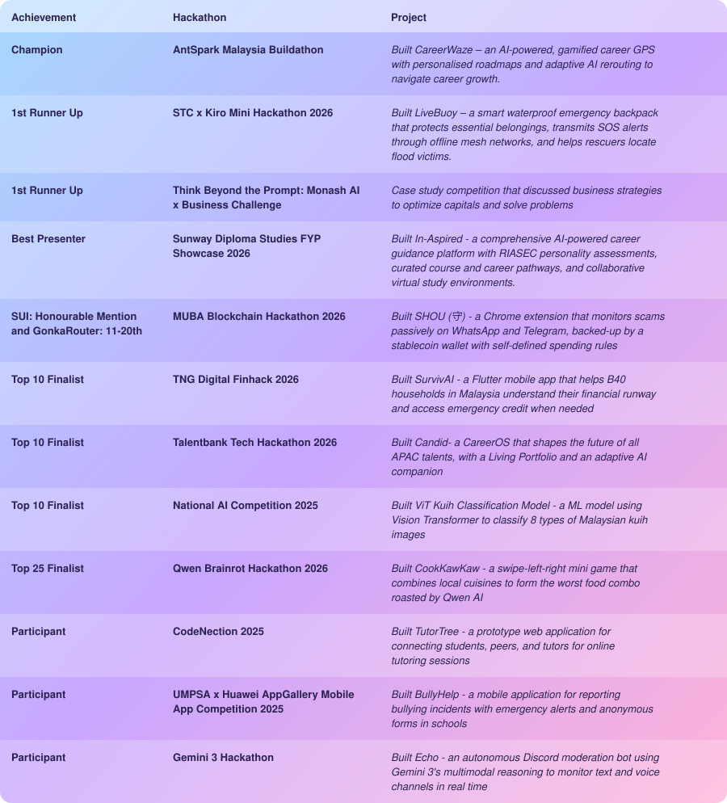

<div align="center">
  
  

  
  <a href="https://git.io/typing-svg"></a>
</div>
  
<p align="left">
    <b>Knowing Me A Lil' More</b>
    <br/>
    I <b>love</b> turning matcha powder into clean code. My happy place is a hackathon floor with a team, a problem, and a deadline. Currently building my arsenal to tackle real-world problems through software that actually helps people.
    <br/><br/>
    <b>My mantra: "Build fast, learn faster."</b>
</p>
  
<p align="left">
    
</p>

---

### ‧₊˚ ☁️ ⋅ Socials ⋅ ☁️ ˚₊‧ 

<p align="left">
    <a href="https://linkedin.com/in/hanatangyh" target="blank">
      
    </a>
    <a href="mailto:2006yihui@gmail.com">
      
    </a>
    <a href="https://www.mewhacks.com" target="blank">
      
    </a>
    <a href="https://discordapp.com/users/824516886418161675" target="blank">
      
    </a>
    <a href="https://www.reddit.com/user/mewHacks" target="blank">
      
    </a>
</p>

---

### ‧₊˚ 🏆 ⋅ Hackathon Achievements & Hacks ⋅ 🏆 ˚₊‧

<div align="center">
  
</div>

> **My Hackathon Philosophy:**
>
> 🍵 **Matcha (or coffee) is mandatory** (Sometimes sleep is optional, health--)
>
> 🚀 **MVP > Perfection** (Always ship something, ideas come first!)
>
> 🌙 **The best insights come at 3am, lezgo**
>
> 🤝 **Teamwork makes the dream work**

```bash
$ git status
On branch trying-my-best
Changes to be committed:
  (use "git reset HEAD <file>..." to unstage)

	new file:   another-side-project.js
	modified:   sleep-schedule.txt # "what's sleep?"
	deleted:    social-life.db # sorry mom and dad
```

---

### ‧₊˚ 🛠️  ⋅ Tech Stack ⋅ 🛠️  ˚₊‧

<div>

<h4>🌐 Frontend Development</h4>
<p>
    
    
    
    
    
    
</p>

<h4>🖥️ Backend Development</h4>
<p>
    
    
    
    
    
    
    
</p>

<h4>🗄️ Databases</h4>
<p>
    
    
    
</p>

<h4>🤖 Machine Learning & Data Science</h4>
<p>
    
    
    
    
    
</p>

<h4>🛠️ Tools</h4>
<p>
    
    
    
    
    
</p>

</div>

---

### ‧₊˚ 📊  ⋅ GitHub Stats ⋅ 📊  ˚₊‧

<div>
  <table>
    <tr>
      <td>
        
      </td>
      <td>
        
      </td>
    </tr>
  </table>
  
</div>

<br>

<div>
  
```bash
# Run this in your terminal for good vibes 🚀
echo "Keep building. Keep shipping. Don't stop."
```

*"Still writing my story, one commit at a time."*

⭐ **If you read this far: Hey, you're my kind of person. Let's build something stupidly ambitious together.** ⭐

</div>
<br>

<div align="center">
  
</div>

<div>
  
</div>
